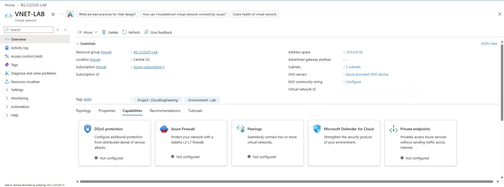
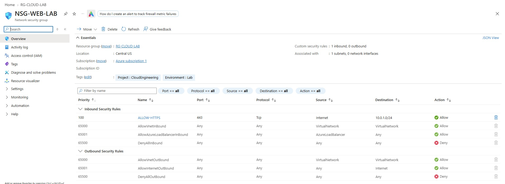
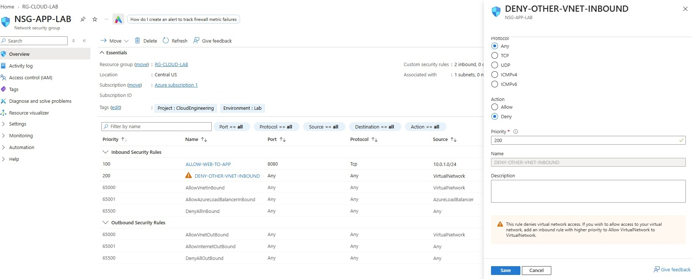

# Azure Networking Infrastructure Lab

## Project Overview
Deployed and configured a segmented Azure Virtual Network
using Azure CLI.

## Environment
- Resource Group: RG-CLOUD-LAB
- Region: Central US
- Virtual Network: VNET-LAB
- Address Space: 10.0.0.0/16

## Network Architecture
| Subnet | Address Space | Network Security Group |
|---|---|---|
| SNET-WEB | 10.0.1.0/24 | NSG-WEB-LAB |
| SNET-APP | 10.0.2.0/24 | NSG-APP-LAB |

## Security Configuration
| Rule | NSG | Protocol/Port | Action |
|---|---|---|---|
| ALLOW-HTTPS | NSG-WEB-LAB | TCP 443 | Allow |
| ALLOW-WEB-TO-APP | NSG-APP-LAB | TCP 8080 | Allow |
| DENY-OTHER-VNET-INBOUND | NSG-APP-LAB | All | Deny |

## Implementation
1. Verified Azure subscription and resource group.
2. Created VNET-LAB in Central US.
3. Created web and application subnets.
4. Created two Network Security Groups.
5. Configured custom inbound security rules.
6. Associated NSGs with their respective subnets.
7. Verified deployed resources through Azure CLI.

## Validation
- VNet: Succeeded
- Both subnets: Succeeded
- Both NSGs: Succeeded
- NSG subnet associations: Verified
- Custom inbound rules: Verified
- Live network connectivity testing: Pending

## Skills Demonstrated
- Azure Virtual Networking
- IP addressing and subnetting
- Network Security Groups
- Azure CLI
- Network segmentation
- Infrastructure documentation

## Next Steps
- Capture Azure Portal screenshots.
- Add a reusable Azure CLI deployment script.
- Test connectivity with temporary workloads after cost review.
- Explore VNet peering and Bicep automation.
  

## Deployment Screenshots

### Azure Resource Group

### Virtual Network

### Subnet Configuration

### Web Network Security Group

### Application Network Security Group

### NSG Security Design Notes

The application subnet includes a custom inbound deny
rule at priority 200.

Azure Portal displays a warning because this rule
restricts traffic from the VirtualNetwork service tag.

This behavior is intentional for the lab.

An inbound allow rule at priority 100 permits TCP 8080
from SNET-WEB to SNET-APP before the deny rule is evaluated.

The design demonstrates NSG priority evaluation,
network segmentation, and least-privilege access.

Live connectivity testing has not yet been performed.
